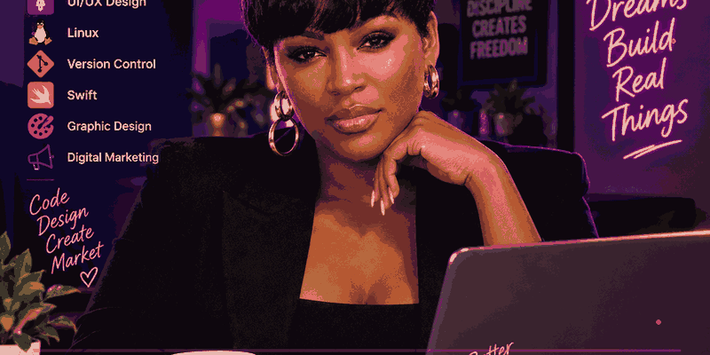

# RoxxyKels
# Hi, I'm a Web Development Student 👋

Welcome to my GitHub profile!

I'm a web development student building my skills in software development, user experience, and digital design. I enjoy exploring how technology, creativity, and strategy come together to create meaningful digital experiences.

With a background in **digital marketing**, I bring a user-focused perspective to my technical learning, combining an understanding of online audiences and brand communication with an interest in building functional, visually engaging websites and applications.

## 💻 What I'm Learning

I'm currently developing my skills in:

* **HTML & CSS:** Building and styling responsive web pages.
* **Java:** Learning programming fundamentals and object-oriented development.
* **UI/UX Design:** Creating intuitive, user-friendly digital experiences.
* **Linux:** Developing command-line and operating system skills.
* **Version Control:** Using Git and GitHub to manage code and collaborate on projects.
* **Swift:** Exploring programming for Apple platforms.
* **Graphic Design:** Developing visual communication and digital design skills.

## 📈 Background & Interests

My experience in **digital marketing** has helped me develop an appreciation for branding, audience engagement, content strategy, and online visibility. I'm interested in applying that experience to web development, UI/UX design, and the creation of digital products that balance usability, functionality, and visual appeal.

## What I Bring
- Digital marketing experience
- Creative problem-solving
- User-focused design thinking
- A passion for learning and building

I'm focused on strengthening my technical foundation, learning best practices, and turning new concepts into working projects.

## 🎯 My Goals

* Build responsive, accessible, and user-friendly websites.
* Strengthen my programming and problem-solving skills.
* Develop a strong portfolio of web and software projects.
* Combine technical development with design and digital marketing.
* Continue learning and exploring new technologies.

## 🤝 Let's Connect

I'm always interested in learning, sharing ideas, and connecting with people in web development, technology, design, and digital marketing.

Thanks for stopping by my profile!

  

## 📈 My GitHub Contributions

  

